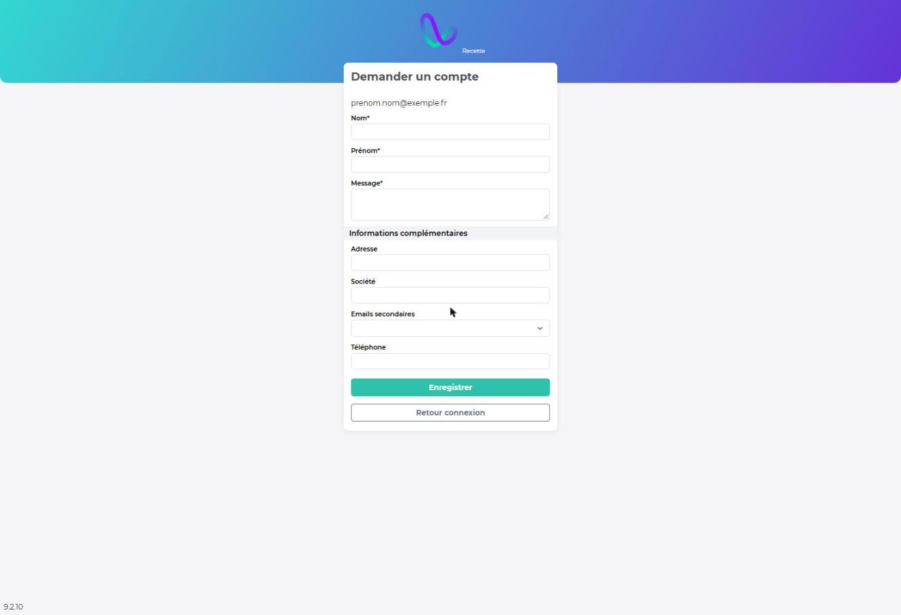

# Utilisateurs

**Chemin :** Paramétrage › Utilisateurs › Utilisateurs

Chaque personne qui se connecte a besoin d'un compte utilisateur rattaché à un [rôle](roles/). Pour une personne qui doit seulement recevoir des emails ou des UL, sans se connecter, créez plutôt un [contact](../../referentiel/contacts.md).


Avec la [connexion SSO](connexion-sso.md), la création de compte depuis la page de connexion et le « mot de passe oublié » sont gérés par votre fournisseur d'identité.


## Créer un utilisateur

Vous pouvez créer un utilisateur depuis le paramétrage, depuis une demande sur la page de connexion, ou en masse par import depuis **Paramétrage | Données | Imports & mises à jour**.

| Champ                                                                         | Description                                                                                                                            |
| ----------------------------------------------------------------------------- | -------------------------------------------------------------------------------------------------------------------------------------- |
| **Statut**                                                                    | Actif ou inactif. Un utilisateur inactif ne peut plus se connecter.                                                                    |
| **Rôle**                                                                      | Donne accès aux fonctionnalités.                                                                                                       |
| **Identifiant utilisateur**                                                   | Identifiant de connexion sur le **web**. Doit être unique et format email.                                                             |
| **Mot de passe / Confirmer le mot de passe**                                  | 8 caractères minimum, dont 1 caractère spécial, 1 chiffre et 1 majuscule.                                                              |
| **Types de livraison, d'acheminement, de service, de tournée, de production** | Types de demandes visibles par l'utilisateur. Voir ci-dessous.                                                                         |
| **Groupes de visibilité**                                                     | Limite les références du stock visibles. Sans groupe, l'utilisateur voit toutes les références.                                        |
| **Business unit (acheminements)**                                             | Pré-remplit le champ Business unit des acheminements créés par l'utilisateur.                                                          |
| **Livreur**                                                                   | Indique un chauffeur-livreur du module Track.                                                                                          |
| **Connexion 14 jours**                                                        | Garde l'utilisateur connecté pendant 14 jours. Option inactive par défaut : pour l'activer, ouvrez un ticket auprès du support Wiilog. |

<figure><figcaption></figcaption></figure>

Un contact est créé automatiquement pour chaque utilisateur (l'inverse n'est pas vrai : un contact n'a pas forcément de compte utilisateur). Les autres champs de la partie **Informations contact** (nom d'affichage, emails secondaires, adresse, trigramme et code signataire, société, service de l'entreprise, téléphone, dropzone, langue et format de date) renseignent ce contact : voir [contacts.md](../../referentiel/contacts.md "mention").


La clé de connexion nomade est générée automatiquement : vous n'avez pas à la renseigner.


| Champ                                     | Web                     | Nomade             |
| ----------------------------------------- | ----------------------- | ------------------ |
| Livraison, acheminement, service, tournée | Tous les types visibles | Aucun type visible |
| Production                                | Tous les types visibles | Sans objet         |

Sur la page de connexion, saisissez votre adresse email, puis cliquez sur le lien **Demandez-en un maintenant**. Le formulaire **Demander un compte** reprend l'adresse email saisie. Renseignez les champs obligatoires **Nom**, **Prénom** et **Message**, et si besoin les **Informations complémentaires** : **Adresse**, **Société**, **Emails secondaires** et **Téléphone**.

Cliquez sur **Enregistrer** pour envoyer la demande. L'administrateur reçoit la demande par email et crée le compte.

<figure><figcaption></figcaption></figure>

Cliquez sur **Nouvel utilisateur**. Le formulaire a deux parties.

### Informations utilisateur

| Champ                                                                             | Description                                                                                                       |
| --------------------------------------------------------------------------------- | ----------------------------------------------------------------------------------------------------------------- |
| **Statut**                                                                        | Actif ou inactif. Un utilisateur inactif ne peut plus se connecter.                                               |
| **Rôle\***                                                                        | Fonctionnalités accessibles.                                                                                      |
| **Identifiant utilisateur\***                                                     | Identifiant de connexion, unique.                                                                                 |
| **Mot de passe\*** / **Confirmer**                                                | 8 caractères minimum, dont 1 caractère spécial, 1 chiffre et 1 majuscule.                                         |
| **Clé de connexion nomade\***                                                     | Mot de passe du nomade (14 à 24 caractères), visible en modification.                                             |
| **Types de livraison / d'acheminement / de service / de tournée / de production** | Types de demandes visibles par l'utilisateur (voir ci-dessous).                                                   |
| **Groupes de visibilité**                                                         | Limite les références de stock visibles. Sans groupe, il voit toutes les références.                              |
| **Business unit (acheminements)**                                                 | Business unit proposée sur ses acheminements.                                                                     |
| **Livreur**                                                                       | Indique un chauffeur-livreur du module Track.                                                                     |
| **Connexion 14 jours**                                                            | L'utilisateur reste connecté 14 jours sans ressaisir son mot de passe, au lieu de la durée de session habituelle. |

### Informations contact

Chaque utilisateur a un contact associé : **Nom d'affichage\***, **Email\*** (identifiant web et adresse des notifications), **Emails secondaires**, **Adresse**, **Trigramme signataire**, **Code signataire** (code PIN pour signer les acheminements groupés), **Société**, **Service de l'entreprise**, **Téléphone**, **Dropzone** (emplacement de dépose de ses arrivages ; imprimé sur l'étiquette si l'utilisateur est acheteur), **Langue\*** et **Format de date\***.

Types de demandes laissés vides

| Champ vide                       | Web                     | Nomade             |
| -------------------------------- | ----------------------- | ------------------ |
| Livraison, acheminement, service | Tous les types visibles | Aucun type visible |
| Production                       | Tous les types visibles | Sans objet         |
| Tournée                          | Tous les types visibles | Aucun type visible |

## Autres façons de créer un compte

* **Page de connexion** (hors SSO) : le bouton **Créer un compte** crée un compte avec le rôle **Aucun accès**. L'administrateur reçoit un email avec un lien vers la fiche pour attribuer un rôle.
* **Import** : [Données › Imports & mises à jour](../donnees/imports-and-mises-a-jour.md), type **Utilisateurs** (CSV en UTF-8). Les utilisateurs importés définissent leur mot de passe avec **Mot de passe oublié**.

## Modifier, désactiver, supprimer

* **Modifier** : cliquez sur la ligne. Évitez de changer l'email.
* **Supprimer** : possible seulement si l'utilisateur ne s'est jamais connecté et n'a créé aucune donnée. Sinon, passez-le en **Inactif** : il ne peut plus se connecter ni être choisi comme destinataire ou acheteur.

## Mot de passe oublié (hors SSO)

Sur la page de connexion, remplissez **Mot de passe oublié**, cliquez sur le lien reçu par email, puis saisissez le nouveau mot de passe.
