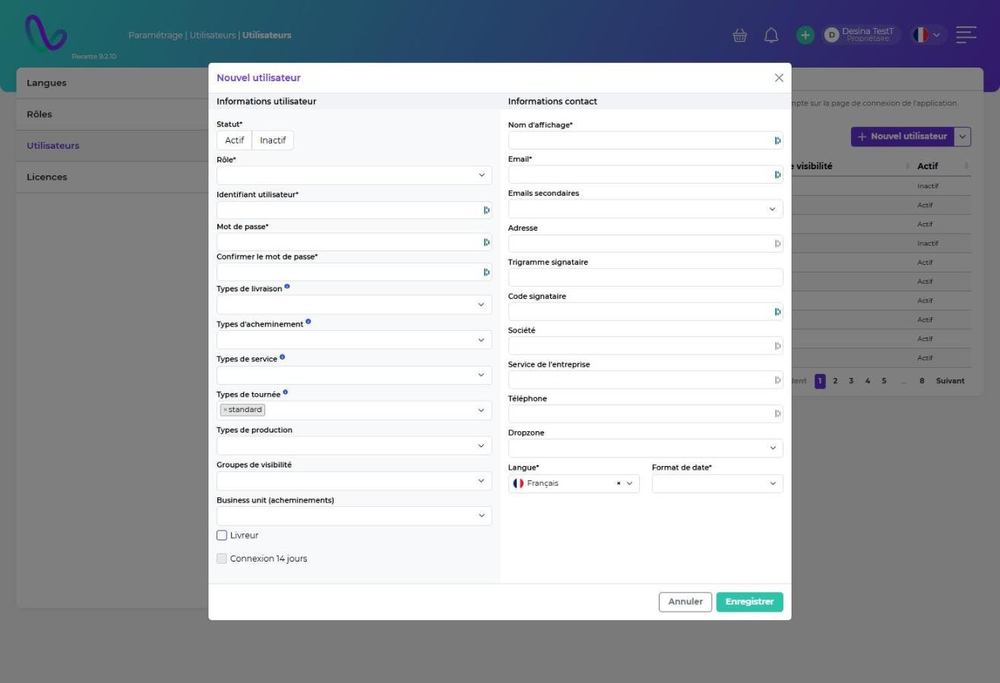

# Utilisateurs

Chaque personne qui utilise Follow GT a besoin d'un compte utilisateur rattaché à un [rôle](roles/). Le rôle détermine les fonctionnalités accessibles.

Pour une personne qui doit seulement recevoir des emails ou des colis, sans se connecter, créez plutôt un [contact](../../referentiel/contacts.md).


Si votre entreprise utilise la [connexion SSO](connexion-sso.md), la création de compte depuis la page de connexion et le « mot de passe oublié » sont gérés par votre fournisseur d'identité.


### Créer un utilisateur

Vous pouvez créer un utilisateur depuis le paramétrage, depuis la page de connexion, ou en masse par import depuis **Paramétrage | Données | Imports & mises à jour**.

#### Depuis le paramétrage

Allez dans **Paramétrage | Utilisateurs | Utilisateurs** et cliquez sur **Nouvel utilisateur**.

| Champ                                                                         | Description                                                                                                                            |
| ----------------------------------------------------------------------------- | -------------------------------------------------------------------------------------------------------------------------------------- |
| **Statut**                                                                    | Actif ou inactif. Un utilisateur inactif ne peut plus se connecter.                                                                    |
| **Rôle**                                                                      | Donne accès aux fonctionnalités.                                                                                                       |
| **Identifiant utilisateur**                                                   | Identifiant de connexion sur le **nomade**. Doit être unique.                                                                          |
| **Email**                                                                     | Identifiant sur le **web** et adresse de réception des notifications. Doit être unique.                                                |
| **Mot de passe / Confirmer le mot de passe**                                  | 8 caractères minimum, dont 1 caractère spécial, 1 chiffre et 1 majuscule.                                                              |
| **Types de livraison, d'acheminement, de service, de tournée, de production** | Types de demandes visibles par l'utilisateur. Voir ci-dessous.                                                                         |
| **Groupes de visibilité**                                                     | Limite les références du stock visibles. Sans groupe, l'utilisateur voit toutes les références.                                        |
| **Business unit (acheminements)**                                             | Pré-remplit le champ Business unit des acheminements créés par l'utilisateur.                                                          |
| **Livreur**                                                                   | Indique un chauffeur-livreur du module Track.                                                                                          |
| **Connexion 14 jours**                                                        | Garde l'utilisateur connecté pendant 14 jours. Option inactive par défaut : pour l'activer, ouvrez un ticket auprès du support Wiilog. |

<figure><figcaption></figcaption></figure>

Un contact est créé automatiquement pour chaque utilisateur (l'inverse n'est pas vrai : un contact n'a pas forcément de compte utilisateur). Les autres champs de la partie **Informations contact** (nom d'affichage, emails secondaires, adresse, trigramme et code signataire, société, service de l'entreprise, téléphone, dropzone, langue et format de date) renseignent ce contact : voir [contacts.md](../../referentiel/contacts.md "mention").


La clé de connexion nomade est générée automatiquement : vous n'avez pas à la renseigner.


**Filtrer les types de demandes visibles**

Ces champs limitent les types de demandes que l'utilisateur voit. Quand un champ est vide :

| Champ                            | Web                     | Nomade             |
| -------------------------------- | ----------------------- | ------------------ |
| Livraison, acheminement, service | Tous les types visibles | Aucun type visible |
| Production                       | Tous les types visibles | Sans objet         |
| Tournée                          | Tous les types visibles | Aucun type visible |

<figure><figcaption></figcaption></figure>

#### Depuis la page de connexion (hors SSO)

Le bouton **Créer un compte** ouvre un formulaire limité : nom d'utilisateur, adresse email, mot de passe, langue et format de date.

Le compte créé reçoit le rôle **Aucun accès**. L'administrateur reçoit un email de demande de compte : le lien de cet email ouvre la fiche de l'utilisateur pour lui attribuer un rôle et compléter son paramétrage.

#### Par import

1. Allez dans **Paramétrage | Données | Imports & mises à jour** et cliquez sur **Ajouter un import**.
2. Choisissez le type de données **Utilisateurs**.
3. Téléchargez le modèle vide, complétez-le, puis ajoutez-le en pièce jointe (CSV encodé en UTF-8).


Les utilisateurs importés reçoivent un mot de passe aléatoire. Ils le définissent avec **Mot de passe oublié** (hors SSO).


### Modifier un utilisateur

Cliquez sur la ligne de l'utilisateur. Tous les champs sont modifiables, mais il est déconseillé de modifier l'email. La réinitialisation du mot de passe se fait aussi depuis ce formulaire.

### Supprimer ou désactiver un utilisateur

Cliquez sur la corbeille à droite de la ligne. La suppression n'est possible que si l'utilisateur ne s'est jamais connecté et n'a créé aucune donnée (arrivage, demande, mouvement…).

Sinon, passez son statut à **inactif**. Il ne peut alors plus se connecter ni être sélectionné comme destinataire ou acheteur.

### Mot de passe oublié (hors SSO)

1. Sur la page de connexion, remplissez le formulaire **Mot de passe oublié**.
2. Cliquez sur le lien temporaire reçu par email.
3. Saisissez votre nouveau mot de passe.
