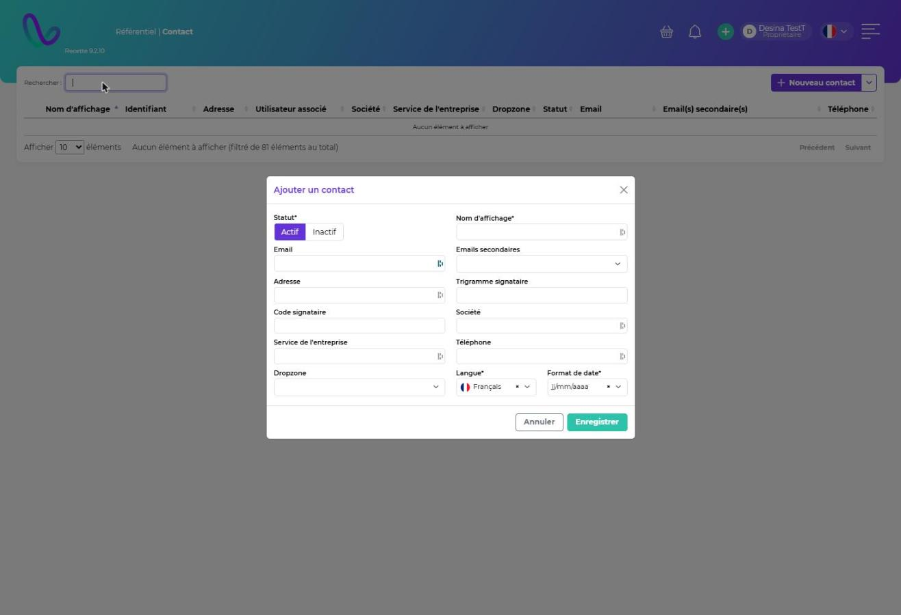

# Contacts

**Chemin :** Référentiel › Contacts

Le référentiel Contacts permet de choisir des personnes dans les formulaires (destinataires d'emails, destinataires d'UL…) **sans leur créer de compte utilisateur**. Il remplace l'ancien référentiel Clients.

* Chaque **utilisateur** a un contact associé, qui porte ses informations (nom, email, téléphone…).
* Un **contact** n'est pas forcément lié à un utilisateur.

## Créer un contact

Cliquez sur **Nouveau contact** et renseignez :

| Champ                                                            | Description                                                                                                                                                      |
| ---------------------------------------------------------------- | ---------------------------------------------------------------------------------------------------------------------------------------------------------------- |
| **Statut\***                                                     | Actif ou inactif.                                                                                                                                                |
| **Nom d'affichage\***                                            | Nom visible dans les listes.                                                                                                                                     |
| **Email** / **Emails secondaires** / **Téléphone** / **Adresse** | Coordonnées.                                                                                                                                                     |
| **Trigramme signataire** / **Code signataire**                   | Utilisés pour la signature des documents. Le code signataire est un code PIN à 4 caractères qui sert à signer les acheminements groupés.                         |
| **Société** / **Service de l'entreprise**                        | Rattachement.                                                                                                                                                    |
| **Dropzone**                                                     | Emplacement ou groupe où déposer les UL destinées au contact. Pour le contact d'un utilisateur acheteur, la dropzone figure sur l'étiquette d'unité de tracking. |
| **Langue\*** / **Format de date\***                              | Langue et format des emails reçus.                                                                                                                               |

Cliquez sur **Enregistrer**. Le menu à côté de **Nouveau contact** propose **Exporter au format CSV**, et le menu **⋮** d'une ligne **Supprimer**.

<figure><figcaption></figcaption></figure>
