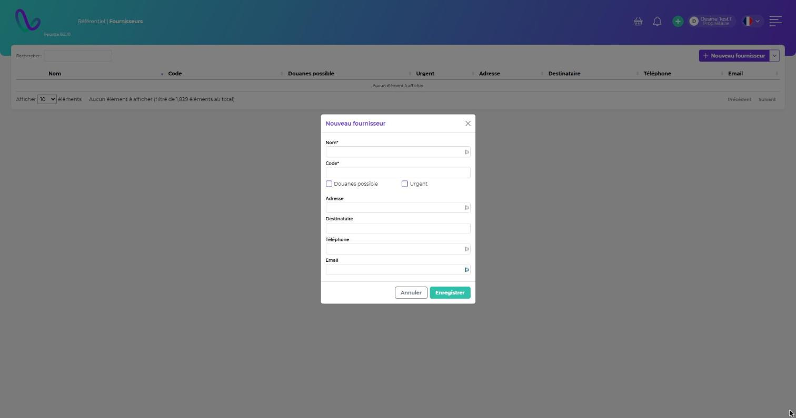

# Fournisseurs

**Chemin :** Référentiel › Fournisseurs

## Créer un fournisseur

Cliquez sur **Nouveau fournisseur** et renseignez :

| Champ                                                   | Description                                                                                                                                                             |
| ------------------------------------------------------- | ----------------------------------------------------------------------------------------------------------------------------------------------------------------------- |
| **Nom\*** / **Code\***                                  | Identité du fournisseur.                                                                                                                                                |
| **Douanes possible**                                    | À la validation d'un arrivage avec ce fournisseur, une fenêtre demande si l'arrivage est sous douane.                                                                   |
| **Urgent**                                              | À la validation d'un arrivage, une fenêtre signale que les UL sont à traiter en urgence, et l'arrivage s'affiche en urgence (voir [Urgences](../urgences/urgences.md)). |
| **Adresse**, **Destinataire**, **Téléphone**, **Email** | Coordonnées du fournisseur.                                                                                                                                             |

Cliquez sur **Enregistrer**. Un fournisseur peut aussi être créé directement depuis le formulaire d'un arrivage ou d'une réception.

<figure><figcaption></figcaption></figure>

## Modifier, exporter, supprimer

* **Modifier** : cliquez sur la ligne.
* **Exporter au format CSV** : flèche à côté de **Nouveau fournisseur**.
* **Supprimer** : menu **⋮** de la ligne. Un fournisseur déjà utilisé ne peut pas être supprimé.
