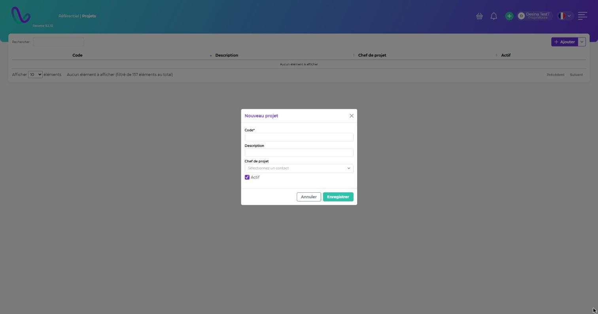

# Projets

**Chemin :** Référentiel › Projets

Cliquez sur **Ajouter** et renseignez :

| Champ              | Description                                                  |
| ------------------ | ------------------------------------------------------------ |
| **Code\***         | Identifiant du projet (ex. : Projet EQUINOX).                |
| **Description**    | Description courte.                                          |
| **Chef de projet** | Responsable du projet, choisi parmi les contacts.            |
| **Actif**          | Seuls les projets actifs sont proposés dans les formulaires. |

Cliquez sur **Enregistrer**. Modifiez un projet en cliquant sur sa ligne. Supprimez-le avec l'icône corbeille de la ligne. Le menu à côté de **Ajouter** propose **Exporter au format CSV**.

<figure><figcaption></figcaption></figure>


Un projet lié à des UL ou à des articles ne peut pas être supprimé : passez-le en inactif.

