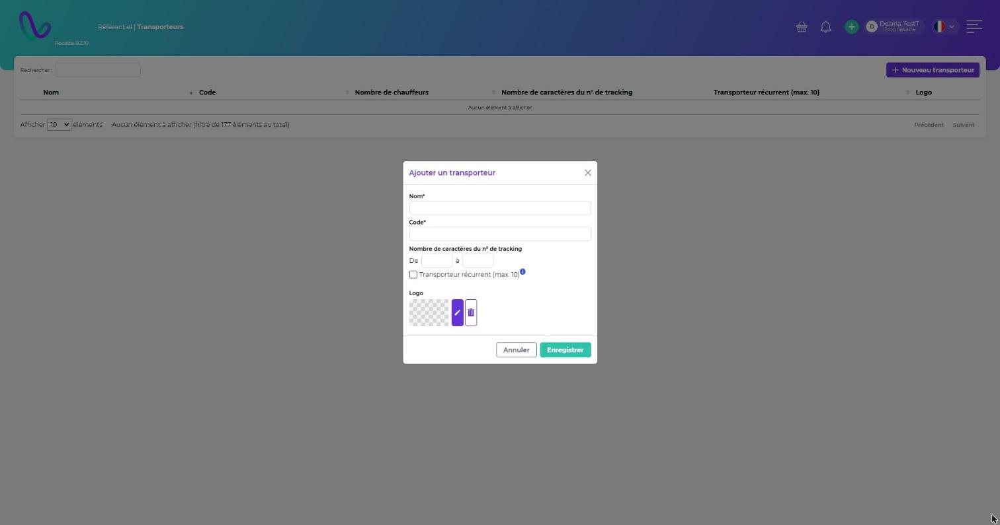

# Transporteurs

**Chemin :** Référentiel › Transporteurs

## Créer un transporteur

Cliquez sur **Nouveau transporteur** et renseignez :

| Champ                                      | Description                                                                                   |
| ------------------------------------------ | --------------------------------------------------------------------------------------------- |
| **Nom\*** / **Code\***                     | Identité du transporteur.                                                                     |
| **Nombre de caractères du n° de tracking** | Longueur minimale (**De**) et maximale (**à**) des numéros de tracking de ce transporteur.    |
| **Transporteur récurrent (max. 10)**       | Le transporteur est proposé en accès rapide (10 au maximum). Un **Logo\*** est alors demandé. |

Cliquez sur **Enregistrer**. Un transporteur peut aussi être créé depuis le formulaire d'un arrivage ou d'une réception.

<figure><figcaption></figcaption></figure>

## Modifier, supprimer

* **Modifier** : cliquez sur la ligne.
* **Supprimer** : menu **⋮** de la ligne. Un transporteur déjà utilisé ne peut pas être supprimé.

La colonne **Nombre de chauffeurs** indique combien de [chauffeurs](chauffeurs.md) sont rattachés au transporteur.
