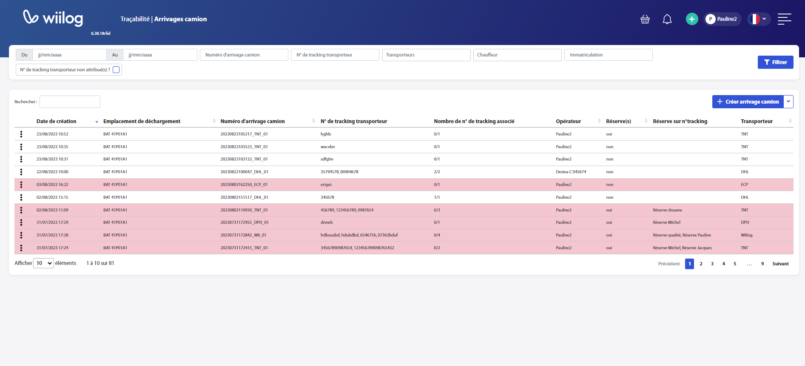
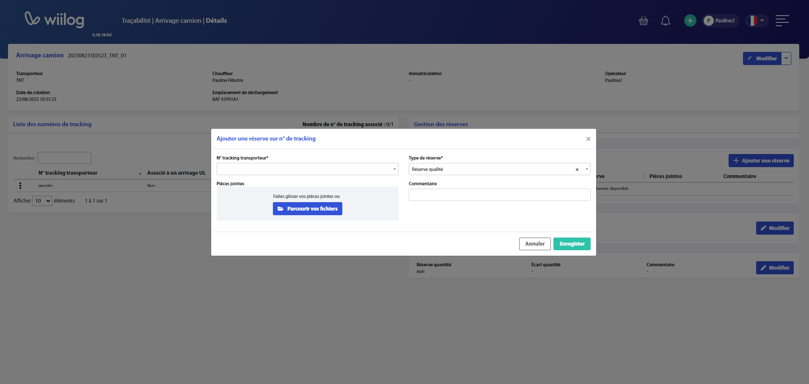

# Arrivages Camion

**Chemin :** Traçabilité › Arrivages camion · Web et nomade

L'arrivage camion trace une livraison dès la sortie du camion : quel transporteur est venu, avec quel chauffeur et quels numéros de tracking. Ensuite, chaque numéro de tracking est rattaché à un [arrivage UL](arrivages-unites-logistiques/).

<figure><figcaption></figcaption></figure>

## Créer un arrivage camion



### Ouvrir le formulaire

Cliquez sur **Créer arrivage camion**.



### Identifier le camion

Renseignez le **Transporteur** (obligatoire), puis selon votre paramétrage : **Chauffeur**, **Fournisseur**, **N° de commande**, **Immatriculation** et **Emplacement de déchargement**.

Le transporteur, le chauffeur ou le fournisseur n'existe pas encore ? Cliquez sur **Créer** à côté du champ.



### Saisir les numéros de tracking

Scannez ou saisissez chaque **numéro de tracking transporteur**. Le compteur **Total** permet de vérifier qu'aucun n'a été oublié.

Certains objets n'ont pas de numéro de tracking ? Indiquez leur nombre dans **Objets sans numéros de tracking transporteur** avec les boutons **−** et **+**.



### Signaler une réserve (si besoin)

Cochez **Réserve général** ou **Réserve quantité +/-** pour une réserve qui porte sur tout l'arrivage.



### Enregistrer

* **Enregistrer** : l'arrivage camion s'ajoute au tableau.
* **Aller vers Arrivage UL** : ouvre un nouvel arrivage UL prérempli avec les informations du camion.




Les champs affichés et obligatoires se règlent dans [Paramétrage › Trace › Arrivages camion](../parametrage/arrivages-camion/).


## Ajouter une réserve sur un numéro de tracking

1. Cliquez sur la ligne de l'arrivage camion pour ouvrir son détail.
2. Dans **Gestion des réserves**, cliquez sur **Ajouter une réserve**.
3. Choisissez le **N° de tracking transporteur** et le **Type de réserve**, puis ajoutez si besoin un commentaire et une pièce jointe.

<figure><figcaption></figcaption></figure>

## Le détail d'un arrivage camion

Cliquez sur une ligne du tableau pour ouvrir le détail. Vous y trouvez :

* les boutons **Créer arrivage UL**, **Modifier**, **Imprimer** et **Supprimer** ;
* la liste des numéros de tracking, avec pour chacun l'arrivage UL qui lui est associé. Pour en ajouter un, cliquez sur **Ajouter un n°tracking transporteur** ;
* la **Gestion des réserves** : réserves générales, réserves de quantité et réserves par numéro de tracking.

## Retrouver un arrivage camion

Le tableau liste tous les arrivages camion, qu'ils aient été créés sur le web ou sur le nomade. La colonne **Nombre de n° de tracking associés** (par exemple 1/4) montre combien de numéros sont déjà rattachés à un arrivage UL.

Filtres disponibles

| Filtre                                               | Description                                                                    |
| ---------------------------------------------------- | ------------------------------------------------------------------------------ |
| **Du** / **Au**                                      | Date de création.                                                              |
| **Numéro d'arrivage camion**                         | Identifiant généré à la création.                                              |
| **N° de tracking transporteur**                      | Numéro de suivi du transporteur.                                               |
| **Emplacement de déchargement**                      | Lieu de déchargement du camion.                                                |
| **Transporteur**, **Chauffeur**, **Immatriculation** | Informations du camion.                                                        |
| **N° de tracking transporteur non attribué(s) ?**    | Affiche les arrivages qui ont encore des numéros de tracking sans arrivage UL. |
| **N° de commande**, **Fournisseurs**                 | Informations de la commande.                                                   |

Le menu **⋮** d'une ligne propose **Imprimer**, **Créer arrivage UL** et **Supprimer**. Pour choisir les colonnes affichées, ouvrez la flèche à côté de **Créer arrivage camion**, puis **Gestion des colonnes**.
